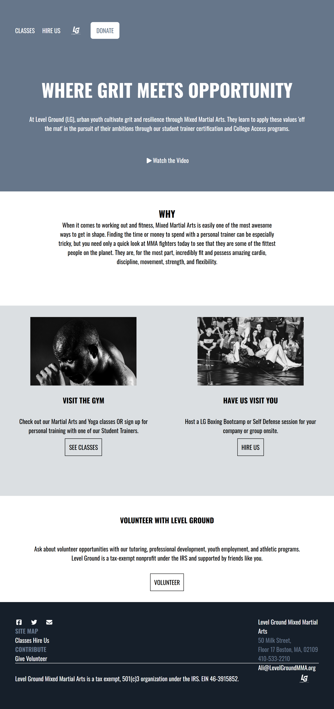

# LevelGroundWireframe
Wireframe Project for Level Ground Gym

## Project Description

A simple wireframe for a Boston nonprofit that uses Mixed Martial Arts for youth development: trainer certification, college access, and community outreach.

### How It's Made:
Tech used: HTML & CSS

## How to Run or View It

1. Clone or download the repository.
2. Open `index.html` in a browser

## View Live Deploy
https://lggym.netlify.app/

## Screenshots

